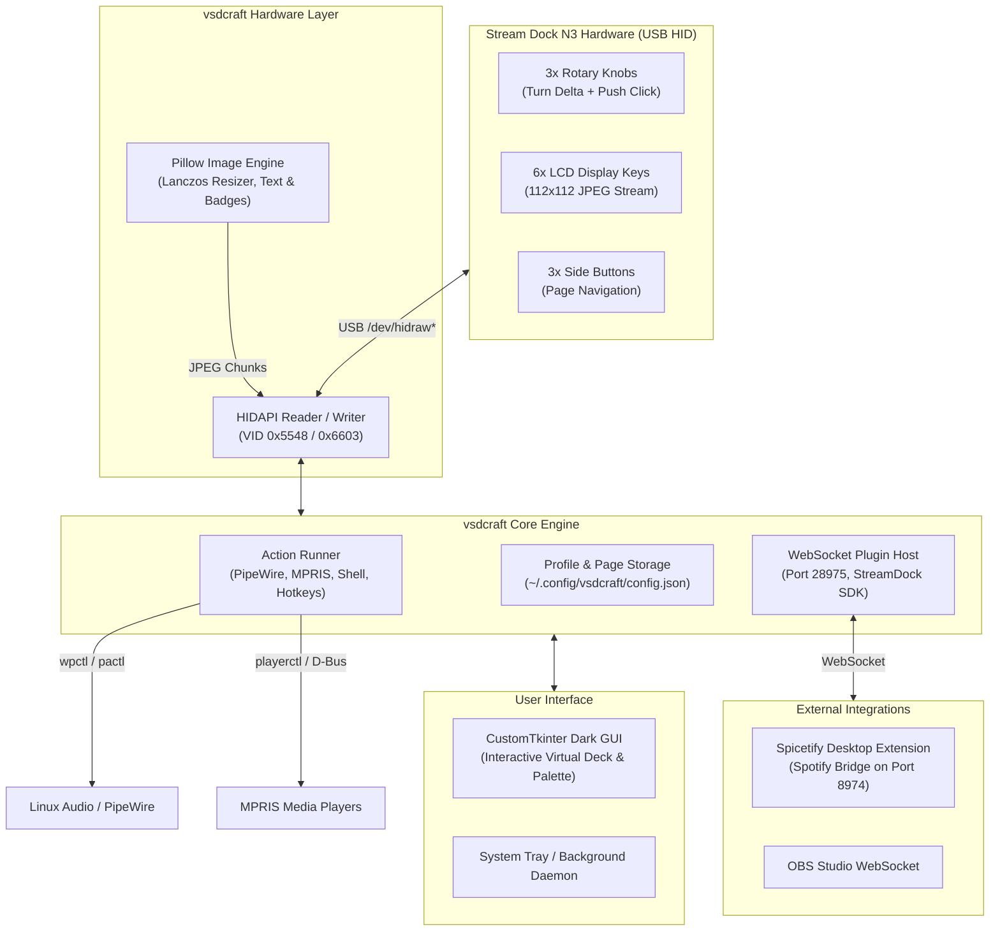

# ⚡ VSDCraft Linux (Stream Dock N3 Controller)

A native, open-source Linux replacement for **VSD Craft** / **Stream Dock**, purpose-built for the **VSDinside Stream Dock N3** (as well as Mirabox N3 and Ajazz AKP03 macro pads).

Features a full modern dark-mode GUI, dynamic LCD key rendering, continuous rotary encoder / knob control, system monitoring, and out-of-the-box compatibility with **StreamDock `.sdPlugin` packages (including Spicetify Spotify)**.

---

## 📸 Architecture & Hardware Layout



---

## 🚀 Key Features

* **Complete VSD Craft Experience on Linux**:
  * Realistic virtual preview of the 6 LCD keys, 3 knobs, and 3 side buttons.
  * Drag-and-drop / single-click action assignment palette.
  * Property inspector to edit titles, commands, URLs, and custom icons.
* **Stream Dock N3 Specifics**:
  * **6 LCD Display Keys**: Crisp 112×112 JPEG streaming with live status, album covers, CPU/RAM meters, and icons.
  * **3 Rotary Encoders (Knobs)**: Smooth clockwise/counter-clockwise volume or brightness adjustments + push clicks for mute/play-pause.
  * **3 Physical Side Buttons**: Instant page switching (Page 1, 2, 3...) or home return.
* **Native Linux Desktop Control**:
  * **PipeWire & PulseAudio**: Native volume adjustment via `wpctl` or `pactl`.
  * **MPRIS Media Player Control**: Works with Spotify, VLC, Firefox, Chrome, and any MPRIS player via `playerctl` or D-Bus.
  * **App Launchers**: Fast launch of Discord, Terminal, Steam, OBS, or custom bash scripts.
  * **Keyboard Macros**: Simulated keystrokes via `xdotool` (X11) or `ydotool` / `wtype` (Wayland).
  * **Live System Monitor**: Real-time dual bar graphs for CPU% and RAM% updated continuously.
* **Direct Spicetify Spotify Integration**:
  * Embedded support for the local Spicetify StreamDock plugin (`http://127.0.0.1:8974`).
  * Dynamic track titles, album art, volume dial control, and play/pause state feedback.
* **Dual Run Modes**:
  * **GUI Mode**: Full configuration window.
  * **Daemon Mode (`--daemon`)**: Lightweight background service that auto-starts on boot via `systemd`.
  * **Simulation Mode (`--mock`)**: Test all actions and UI without physical hardware connected.

---

## 📦 Installation on Linux

### Quick Install (One-Line Script)
Clone the repository and run the setup script:

```bash
git clone https://github.com/henry1056/vsdcraft-linux.git
cd vsdcraft-linux
chmod +x install.sh
./install.sh
```

The script will:
1. Install necessary Python packages (`customtkinter`, `pillow`, `hidapi`, `websockets`, `psutil`).
2. Copy `99-streamdock.rules` to `/etc/udev/rules.d/` so non-root users can access the USB device.
3. Install the application launcher desktop shortcut.

---

## 🎮 How to Run

### 1. Launch the Graphical App
```bash
python3 -m vsdcraft
```

### 2. Run in Virtual / Simulation Mode (No hardware needed)
```bash
python3 -m vsdcraft --mock
```

### 3. Run Headless Background Daemon
```bash
python3 -m vsdcraft --daemon
```

### 4. Enable Background Auto-Start on System Boot
To have the controller listen to your buttons and knobs automatically when you log into your Linux desktop:

```bash
mkdir -p ~/.config/systemd/user/
cp vsdcraft.service ~/.config/systemd/user/
systemctl --user daemon-reload
systemctl --user enable --now vsdcraft.service
```

---

## 🛠️ USB Permissions (udev Rule)

If your Stream Dock N3 does not connect or says permission denied, ensure the udev rule is loaded:

```bash
sudo cp 99-streamdock.rules /etc/udev/rules.d/99-streamdock.rules
sudo udevadm control --reload-rules
sudo udevadm trigger
```
Then unplug the Stream Dock USB cable and plug it back in.

---

## 🎵 Using with Spicetify (Spotify Integration)

This app works directly with the `spicetify-extension` and `streamdock-plugin`:
1. Ensure your Spicetify extension is active in Spotify desktop.
2. In VSDCraft, assign:
   * **Key 1**: `spicetify_playpause` (toggles playback and displays track info)
   * **Knob 1**: `spicetify_volume` (rotates Spotify volume, click to mute/toggle)
   * **Key 2**: `mpris_next` (skip track)

---

## 📂 File Structure

```
vsdcraft-linux/
├── install.sh                  # Automated Linux installer
├── 99-streamdock.rules         # Udev USB HID rules
├── requirements.txt            # Python requirements
├── vsdcraft.desktop            # Application launcher
├── vsdcraft.service            # Systemd user unit
└── vsdcraft/
    ├── __main__.py             # CLI launcher (--mock, --daemon)
    ├── daemon.py               # Headless background service
    ├── hardware/
    │   ├── device.py           # USB HID driver, image chunker, event listener
    │   └── discovery.py        # VID/PID hardware matching
    ├── core/
    │   ├── actions.py          # PipeWire, MPRIS, Shell, Hotkeys, Spicetify
    │   ├── config.py           # Profile & page management
    │   ├── image_engine.py     # Pillow 112x112 LCD image renderer
    │   └── plugin_host.py      # StreamDock WebSocket plugin server
    └── gui/
        └── app.py              # CustomTkinter modern dark-mode GUI
```
